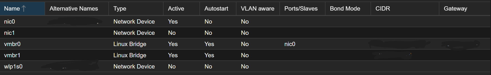
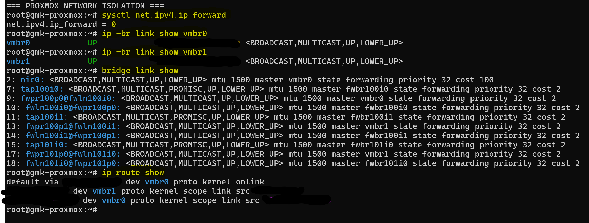
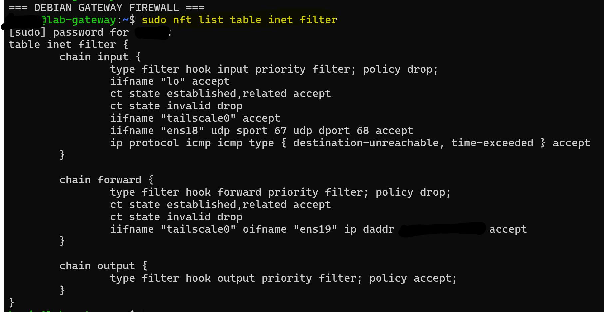
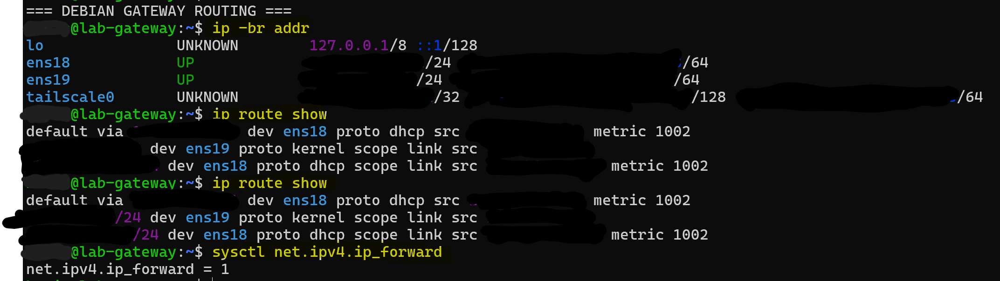
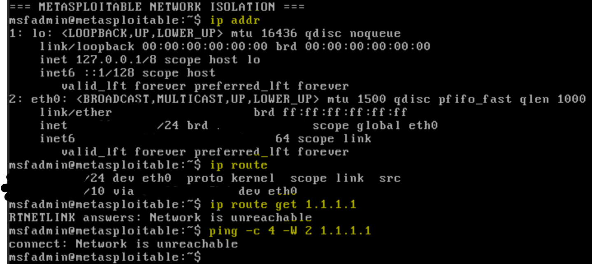
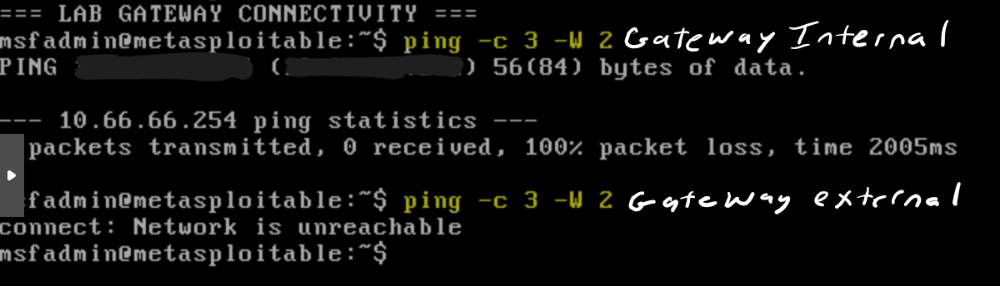
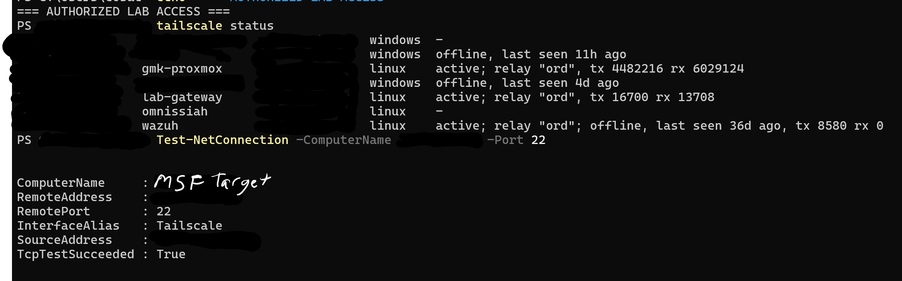

# Security Validation Report
## Proxmox Cybersecurity Homelab

**Project:** Proxmox Cybersecurity Homelab  
**Platform:** Proxmox VE 9.2  
**Validation Date:** November 2026  
**Status:** Initial Security Validation Completed — Additional Testing Recommended

---

## 1. Executive Summary

This report documents security validation activities performed on a Proxmox-based cybersecurity homelab designed for controlled penetration testing and vulnerability research.

The environment includes an intentionally vulnerable Metasploitable 2 virtual machine, a Debian Linux gateway, an isolated virtual network, and Tailscale-based remote access.

The primary security objectives were to:

- Separate intentionally vulnerable systems from the physical home network.
- Prevent Metasploitable 2 from accessing the public internet.
- Restrict network forwarding through explicit firewall policies.
- Allow authorized remote access through Tailscale.
- Verify the configuration using Linux networking utilities and Windows connectivity tests.

**Validation outcome:** Testing confirmed virtual network separation, restrictive gateway firewall policies, disabled IPv4 forwarding on the Proxmox host, absence of a usable public-internet route from Metasploitable, intentional denial of internal ICMP echo requests to the gateway, and successful authorized SSH connectivity through the Tailscale interface.

Additional testing is required to fully validate restrictions on connections from Metasploitable to the Proxmox host and home LAN.

---

## 2. Lab Architecture

### Infrastructure Components

| Component | Role |
|---|---|
| GMKtec NucBox G3 Plus | Physical virtualization host |
| Proxmox VE 9.2 | Virtualization platform |
| `vmbr0` | Upstream/home LAN bridge |
| `vmbr1` | Internal laboratory bridge |
| VM 100 — Debian Gateway | Routing, firewall enforcement, Tailscale access |
| VM 101 — Metasploitable 2 | Intentionally vulnerable penetration-testing target |
| Tailscale | Encrypted overlay network for authorized remote access |

### Network Design

**`vmbr0` — Upstream Network**

Connected to the physical network interface and provides upstream connectivity for the Proxmox host and Debian gateway.

**`vmbr1` — Isolated Laboratory Network**

Configured without a physical bridge port. It connects the Debian gateway's laboratory interface and Metasploitable 2.

The Proxmox host also has an IPv4 address assigned to `vmbr1`. This creates a potential direct connection between the hypervisor and laboratory systems that requires additional security validation.

### Debian Gateway Interfaces

| Interface | Function |
|---|---|
| `ens18` | Upstream/home LAN |
| `ens19` | Isolated laboratory network |
| `tailscale0` | Remote-access overlay |

Actual LAN and Tailscale addresses are intentionally omitted from this public report.

See [Network Architecture](architecture.md) for the logical network diagram.

---

## 3. Validation Methodology

Security validation was performed using read-only configuration inspection and targeted connectivity tests.

The following tools were used:

- `ip` — Network interfaces, routing, and neighbor discovery.
- `bridge` — Linux bridge membership and interface state.
- `sysctl` — Kernel IPv4 forwarding configuration.
- `nft` — nftables firewall policy inspection.
- `ping` — ICMP connectivity testing.
- `tailscale` — Overlay network status.
- `Test-NetConnection` — Windows TCP connectivity testing.

Testing was conducted against personally administered laboratory infrastructure.

No external penetration-testing targets were involved.

The tests did not require enabling internet access on Metasploitable or weakening the gateway's firewall policies.

---

## 4. Proxmox Host Network Isolation

### Objective

Verify that the Proxmox host does not provide ordinary IPv4 routing between the isolated laboratory network and the home LAN.

### Commands

```bash
sysctl net.ipv4.ip_forward
ip -br link show vmbr0
ip -br link show vmbr1
bridge link show
ip route show
```

### Observed Results

The Proxmox host reported:

```text
net.ipv4.ip_forward = 0
```

Both virtual bridges were active.

Bridge membership inspection confirmed that:

- The upstream bridge contained the physical network interface.
- The laboratory bridge contained virtual machine network interfaces.
- No physical network interface was attached to the laboratory bridge.

The routing table contained directly connected routes for the upstream and laboratory networks.

### Assessment

**PASS — IPv4 forwarding disabled.**

The Proxmox host was not configured to perform ordinary IPv4 routing between its connected networks.

The absence of a physical uplink on the laboratory bridge also supports Layer 2 network separation.

**Limitation:** The hypervisor remains directly addressable on the laboratory subnet. Disabled IP forwarding does not prevent connections to services running locally on the hypervisor.

### Evidence





---

## 5. Debian Gateway Firewall Validation

### Objective

Verify that the Debian gateway uses a restrictive firewall policy and explicitly controls traffic forwarded into the laboratory.

### Command

```bash
sudo nft list table inet filter
```

### Observed Results

The gateway's nftables configuration included:

**Input chain:**

```text
type filter hook input priority filter; policy drop;
```

**Forward chain:**

```text
type filter hook forward priority filter; policy drop;
```

**Output chain:**

```text
type filter hook output priority filter; policy accept;
```

The forwarding chain included the following controls:

- Allow established and related traffic.
- Drop invalid connection states.
- Allow traffic arriving through `tailscale0` and leaving through `ens19` when destined for the designated laboratory subnet.
- Drop other forwarded traffic by default.

The input chain permitted loopback traffic, established and related connections, Tailscale interface traffic, required DHCP responses, and selected ICMP error messages.

**Internal ICMP restriction:** The input chain does not include an allow rule for ICMP echo requests arriving from `ens19`. Consequently, new ping requests originating from Metasploitable and addressed to the Debian gateway itself are intentionally denied by the default-DROP input policy.

This restriction applies to traffic destined for the gateway, rather than all ICMP traffic traversing the laboratory network.

### Assessment

**PASS — Restrictive firewall configuration verified.**

The Debian gateway uses default-DROP policies for incoming and forwarded traffic.

The configured forwarding exception permits authorized overlay traffic toward the laboratory network while omitting a general allow rule for new lab-originated connections toward the home LAN or internet.

The gateway also contains Tailscale-managed firewall and NAT rules. The inspection establishes the configured policy but does not constitute a complete packet-level enforcement audit.

### Evidence



---

## 6. Debian Gateway Routing Validation

### Objective

Verify the gateway's interface assignments and IPv4 forwarding configuration.

### Commands

```bash
ip -br addr
ip route show
sysctl net.ipv4.ip_forward
```

### Observed Results

The Debian gateway reported active upstream, laboratory, and Tailscale interfaces.

Its routing table showed:

- A default route through the upstream interface.
- A directly connected laboratory network through `ens19`.
- A directly connected upstream network through `ens18`.

IPv4 forwarding was enabled:

```text
net.ipv4.ip_forward = 1
```

### Assessment

**PASS — Gateway routing configuration verified.**

The Debian gateway is configured to forward IPv4 traffic between interfaces, subject to applicable firewall policies.

This differs intentionally from the Proxmox host, where IPv4 forwarding is disabled.

### Evidence



---

## 7. Metasploitable Internet Isolation

### Objective

Determine whether Metasploitable 2 has a usable network route to a public internet destination.

### Commands

```bash
ip addr
ip route
ip route get 1.1.1.1
ping -c 4 -W 2 1.1.1.1
```

### Observed Results

Metasploitable's network interface was active and assigned an address within the isolated laboratory subnet.

The routing table did not provide a usable route to the tested public destination.

The route lookup returned:

```text
RTNETLINK answers: Network is unreachable
```

The ICMP test returned:

```text
connect: Network is unreachable
```

### Assessment

**PASS — No usable route to the tested public destination.**

Metasploitable could not initiate traffic toward the tested public IP address.

The observed failure occurred at the routing stage, before traffic could be evaluated by the Debian gateway firewall.

Therefore, this test validates a routing restriction rather than demonstrating an actual firewall drop.

The result supports the objective of keeping the intentionally vulnerable system disconnected from the public internet.

**Limitation:** This was an IPv4 test against one destination. It does not independently establish the absence of all possible external connectivity paths, including IPv6 or other network interfaces.

### Evidence



---

## 8. Laboratory Gateway Connectivity and Intentional ICMP Restriction

### Objective

Verify local network connectivity between Metasploitable 2 and the Debian gateway while confirming the intended restriction on internal ICMP echo requests.

### Security Design

The Debian gateway is intentionally configured not to respond to ICMP echo requests originating from the isolated laboratory network.

Its nftables input chain uses a default-DROP policy and does not contain an exception permitting ICMP echo requests arriving through `ens19`.

The firewall allows selected ICMP error messages but does not generally permit ICMP echo requests from the lab.

This configuration reduces unnecessary responses from the gateway to systems operating within the intentionally vulnerable environment.

### Commands

```bash
ping -c 3 -W 2 GATEWAY_LAB_IP
ip neigh show
```

`GATEWAY_LAB_IP` represents the Debian gateway's internal laboratory address.

### Observed Results

The ICMP test returned:

```text
3 packets transmitted, 0 received, 100% packet loss
```

A separate neighbor-table inspection previously showed the gateway address in the `REACHABLE` state.

### Assessment

**PASS — Observed behavior consistent with intentional ICMP restrictions.**

The neighbor-table result supports successful Layer 2 address resolution between Metasploitable and the Debian gateway.

The absence of ICMP echo replies is consistent with the gateway's configured default-DROP input policy.

This is an expected outcome under the current security design and does not, by itself, indicate a failed network connection.

**Validation limitation:** Although the observed behavior matches the firewall configuration, packet counters or tracing were not collected to independently confirm the specific firewall rule responsible for dropping the requests.

### Evidence



---

## 9. Authorized Tailscale Remote Access

### Objective

Verify that an authorized Windows client can reach the Metasploitable SSH service through the Tailscale network interface without installing Tailscale directly on the vulnerable virtual machine.

### Commands

Executed from Windows PowerShell:

```powershell
tailscale status
Test-NetConnection -ComputerName LAB_TARGET_IP -Port 22
```

`LAB_TARGET_IP` represents Metasploitable's isolated laboratory address.

### Observed Results

Tailscale status identified the Debian gateway as an active overlay-network peer.

The TCP connectivity test reported:

```text
RemotePort       : 22
InterfaceAlias   : Tailscale
TcpTestSucceeded : True
```

### Assessment

**PASS — Authorized SSH connectivity verified.**

The Windows client successfully established a TCP connection to Metasploitable's SSH port.

The Windows networking output identified the Tailscale interface as the connection path.

Metasploitable did not require a locally installed Tailscale client.

This demonstrates that the gateway-based remote access architecture supports access to the isolated laboratory.

**Limitation:** This test confirms successful access from one authorized client. It does not independently verify the rejection of unauthorized Tailscale peers or devices outside the overlay network.

### Evidence



---

## 10. Security Validation Summary

| ID | Security Control | Result | Status |
|---|---|---|---|
| SV-01 | Proxmox virtual machines operational | Both VMs running | PASS |
| SV-02 | Laboratory bridge has no physical uplink | Confirmed through bridge configuration | PASS |
| SV-03 | Proxmox IPv4 forwarding disabled | Kernel setting returned `0` | PASS |
| SV-04 | Debian gateway forwarding enabled | Kernel setting returned `1` | PASS |
| SV-05 | Gateway firewall default-deny configuration | Input and forward policies set to DROP | PASS |
| SV-06 | Metasploitable public IPv4 route | Tested destination unreachable | PASS |
| SV-07 | Internal gateway ICMP restriction | Ping denied as intended; neighbor discovery observed | PASS — Configuration Consistent |
| SV-08 | Authorized Tailscale SSH access | TCP connection succeeded | PASS |
| SV-09 | Metasploitable-to-Proxmox management restrictions | Not tested | PENDING |
| SV-10 | Metasploitable-to-home-LAN restrictions | Not directly tested | PENDING |
| SV-11 | Unauthorized remote access restrictions | Not tested | PENDING |

The PASS results describe the specific configuration checks or connectivity tests performed, not a certification of complete network isolation.

---

## 11. Security Considerations and Remaining Risks

### 11.1 Hypervisor Exposure to the Laboratory

The Proxmox host has an IPv4 address assigned to the isolated laboratory bridge.

Although IPv4 forwarding is disabled, laboratory systems may still be able to reach services running directly on the hypervisor.

**Recommended follow-up:** Verify whether management ports, including Proxmox HTTPS management and SSH, are accessible from the laboratory network. Consider removing the host's laboratory IP address or restricting host-bound traffic if it is not operationally required.

### 11.2 Gateway Firewall Enforcement

The Debian gateway's forwarding rules use a default-DROP policy.

However, the Metasploitable public-internet test failed because no usable route was available. It did not generate a forwarded packet that could demonstrate an nftables drop.

**Recommended follow-up:** Validate firewall enforcement using controlled traffic and firewall counters or packet tracing without permanently enabling internet connectivity on the vulnerable target.

### 11.3 Tailscale Access Restrictions

The gateway permits traffic arriving on its Tailscale interface, with the forwarding exception restricted to the laboratory subnet.

**Recommended follow-up:** Review Tailscale access policies to ensure only authorized identities and devices can reach the laboratory gateway and vulnerable targets.

### 11.4 IPv6 and Other Network Paths

The completed isolation tests primarily examined IPv4 behavior.

**Recommended follow-up:** Verify IPv6 forwarding, addressing, and firewall behavior, and confirm no unintended network interfaces or alternate routes bypass the intended segmentation.

### 11.5 Persistence of Security Controls

The validation captured the active configuration at the time of testing.

**Recommended follow-up:** Confirm that firewall policies, bridge configurations, and forwarding settings remain effective following system restarts and updates.

---

## 12. Lessons Learned

**Network isolation requires multiple controls.** Virtual bridges, routing restrictions, and firewall policies provide different forms of protection. No single configuration setting proves complete isolation.

**Routing failures and firewall drops are different outcomes.** A `Network is unreachable` error demonstrates a routing restriction. A firewall enforcement claim requires evidence that traffic reached the firewall and was denied.

**Intentional ICMP restrictions must be interpreted correctly.** An unsuccessful ping does not automatically indicate a broken connection. In this environment, the Debian gateway's firewall intentionally denies internal ICMP echo requests while allowing authorized traffic through separately defined policies.

**Authorized access should be tested independently.** The successful Windows TCP test confirmed that the intended remote-access path works while the vulnerable machine remains disconnected from the public internet.

**The hypervisor is part of the attack surface.** Assigning an address to an isolated bridge can make host services reachable from laboratory systems even when inter-network forwarding is disabled.

**Security documentation should distinguish evidence from assumptions.** Recording exact commands, observed outcomes, and unverified boundaries makes the project reproducible and technically defensible.

---

## 13. Conclusion

The Proxmox cybersecurity homelab demonstrated several functioning security controls during initial validation.

The environment uses an internal virtual bridge without a physical uplink, disabled IPv4 forwarding on the Proxmox host, and a Debian gateway configured with restrictive nftables policies.

Metasploitable 2 had no usable route to the tested public internet destination. Its ICMP echo requests to the Debian gateway received no responses, consistent with the gateway's intentional internal ping restrictions.

An authorized Windows client successfully connected to Metasploitable's SSH service through the Tailscale interface.

These findings support the project's intended architecture: **a remotely accessible cybersecurity testing environment with network separation and restricted connectivity for intentionally vulnerable systems.**

The current evidence does not establish complete isolation from every possible network path. Hypervisor management exposure, home-LAN access restrictions, and unauthorized-client access remain subjects for additional testing.

---

## 14. Supporting Evidence

| Screenshot | Description |
|---|---|
| [01-proxmox-vms.png](screenshots/01-proxmox-vms.png) | Proxmox virtual machine overview |
| [02-proxmox-bridges.png](screenshots/02-proxmox-bridges.png) | Physical and virtual network bridge configuration |
| [03-gateway-routing.png](screenshots/03-gateway-routing.png) | Debian gateway interfaces, routing, and forwarding |
| [04-firewall-policy.png](screenshots/04-firewall-policy.png) | nftables firewall configuration |
| [05-proxmox-routing.png](screenshots/05-proxmox-routing.png) | Hypervisor routing and disabled forwarding |
| [06-metasploitable-isolation.png](screenshots/06-metasploitable-isolation.png) | Metasploitable public-internet routing restriction |
| [07-lab-gateway-connectivity.png](screenshots/07-lab-gateway-connectivity.png) | Intentional internal ICMP restriction |
| [08-authorized-tailscale-access.png](screenshots/08-authorized-tailscale-access.png) | Successful authorized SSH connectivity |

**Documentation note:** Internal LAN addresses, Tailscale addresses, MAC addresses, and identifying network information have been omitted or redacted from public evidence.
